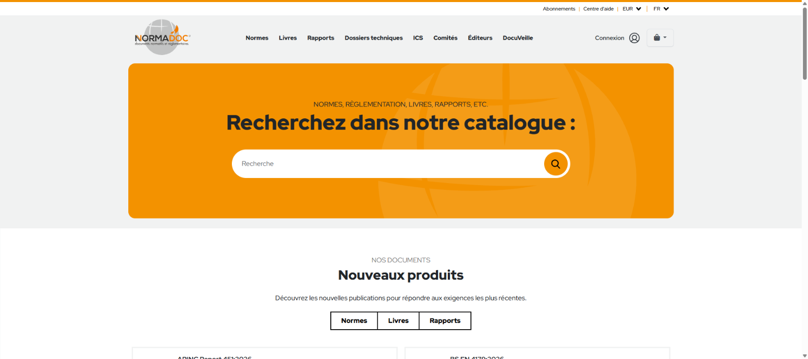
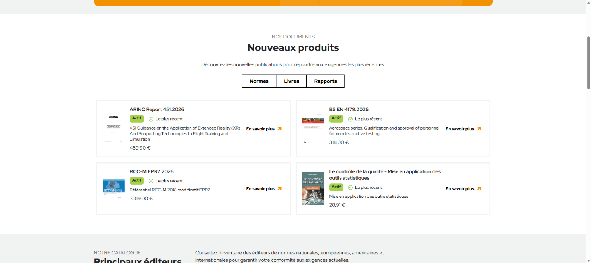

# Normadoc : API d'import de données MS SQL Server → Sylius

> Vitrine d'un projet professionnel réalisé chez **INPEC (Ingénieur Patrice Edeline Conseils)** pour **Normadoc**, distributeur de normes techniques, livres et rapports.
> Le code appartient à l'employeur et reste privé : ce dépôt présente le projet et des captures d'écran.

🔗 **Site en ligne : [normadoc.com](https://www.normadoc.com)**

## Le projet

Normadoc vend en ligne des normes (AFNOR, BSI, ISO, ARINC…), des livres et des rapports techniques. Son catalogue vient d'une base **MS SQL Server** et la boutique tourne sur **Sylius**, l'e-commerce basé sur Symfony.

## Ce que j'ai réalisé

- **API d'import** des données de MS SQL Server vers Sylius : produits, éditeurs, catégories, prix.
- Travail en **équipe agile**, avec **GitLab CI/CD** et **Docker** du développement à la production.
- Participation aux mises en production et au suivi (journaux, monitoring).

## Technologies

PHP · Symfony · Sylius · MS SQL Server · MySQL · Docker · GitLab CI/CD

## Captures d'écran

**Page d'accueil et recherche dans le catalogue**

**Produits importés dans la boutique**

---

Axel (Mostapha) Ouahmane · [LinkedIn](https://www.linkedin.com/in/axel-ouahmane) · [GitHub](https://github.com/AxelOuahmne)
